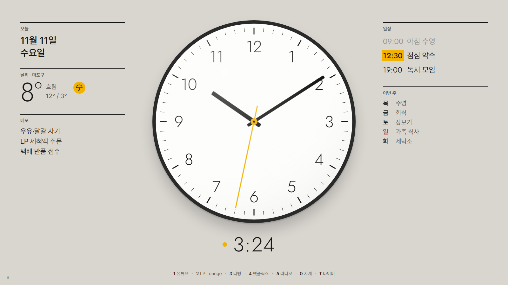
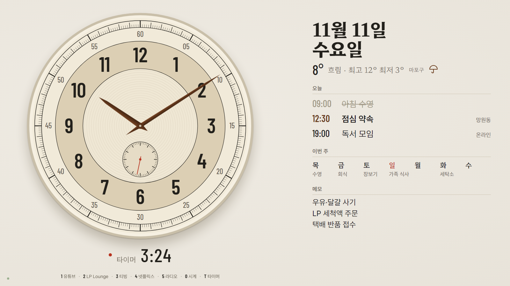
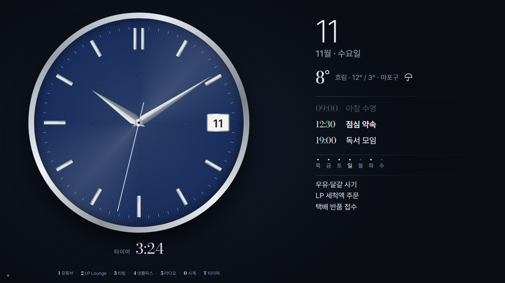
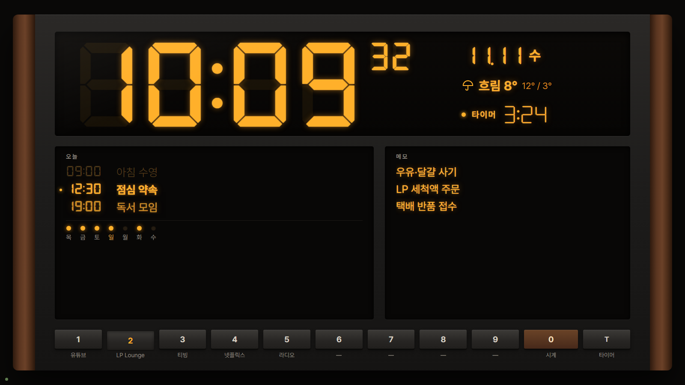
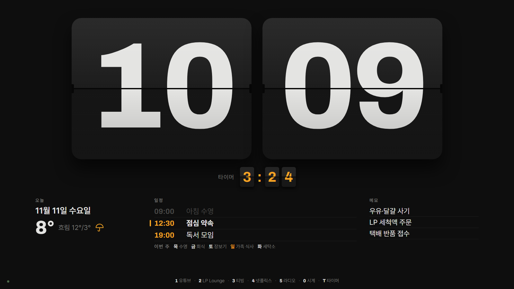
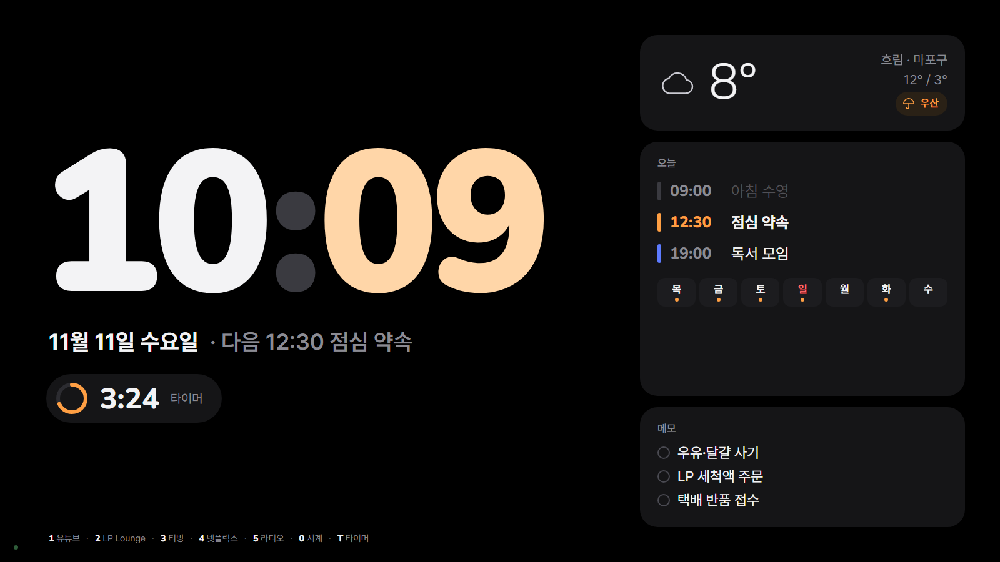

# DeskClock — 식탁 위 탁상시계 겸 숫자패드 미디어 런처

상시 켜 둔 윈도우 노트북을 식탁 위 탁상시계로 쓰는 전체화면 앱입니다. 평소에는 시계·날씨·오늘과 이번 주 일정·메모만 정갈하게 보여 주고, 식사할 때는 숫자패드 한 번으로 유튜브나 음악을 켰다가 `0`으로 시계에 돌아옵니다.



## 테마 6종 (라이트·다크)

| 아날로그 | | |
|---|---|---|
|  바우하우스(기본) |  섹터 다이얼 |  네이비 다이얼 |

| 디지털 | | |
|---|---|---|
|  리시버 |  플립 |  스탠바이 |

화면 속 일정·날씨는 예시 자료입니다.

## 기능

- **숫자패드 단축키**: `1`~`9` 등록한 링크·프로그램 실행, `+`/`−` 볼륨. 시계 화면이 맨 앞에 있을 때만 0~9·+/− 동작, 유튜브 등 다른 창에서는 숫자키가 그대로 입력됩니다. 설정에서 한 번에 끄고 켭니다. NumLock이 켜져 있어야 합니다.
- **실행 후 키 보내기**: 슬롯마다 지정한 단축키(예: ChatGPT 음성 채팅 `Ctrl+Alt+Shift+V`)를 앱이 맨 앞에 뜬 뒤 한 번 자동으로 누릅니다. 설정 → 단축키에서 녹화합니다. 슬롯의 **실행 후 시계로 돌아오기**를 켜면 키를 보낸 1.5초 뒤 시계가 다시 앞으로 옵니다.
- **웹 링크**: Brave(기본)·Chrome·Edge·기본 브라우저 중 선택, 평소 프로필 그대로 주소창 없는 창으로 엽니다.
- **타이머**: `T` 또는 숫자패드 `/` → `분.초` 입력(`1.3`=1분 3초, `1.35`=1분 35초, `10`=10분) → `Enter` 시작, 다시 `Enter` 초기화, `Space` 일시정지. 끝나면 알림음과 함께 시계가 맨 앞으로 옵니다.
- **연동**: 구글 캘린더(일정), Google Tasks(메모) 읽기 전용(1분마다 갱신). 날씨는 Open-Meteo(기상청 모델), 비 예보·미세먼지 나쁨일 때만 우산·마스크 아이콘.
- **야간**: 색 모드는 기본 라이트이고, 시간대별 자동 다크모드는 설정에서 켜는 선택 사항입니다. 야간 패널 밝기 최소화도 기본 끔(설정에서 켜면 아침에 복구).
- **화면 언어**: 설정 → 화면에서 한국어(기본)·中文·English를 고르면 시계 화면·설정·알림 문구가 즉시 바뀝니다(재시작 없음). 일정·메모 제목과 슬롯 이름은 입력한 그대로 보입니다.
- **상태 점**: 화면 구석의 작은 점으로 네트워크·등록한 서버 상태 표시.
- **Windows 시작 시 자동 실행**(설정에서 켜기).

## 설치

[Releases](../../releases)에서 `DeskClock-<버전>-portable.exe`를 받아 원하는 폴더에 두고 실행합니다. 설치 과정은 없습니다. 코드 서명이 없어 처음 실행 때 Windows SmartScreen 경고가 뜰 수 있습니다.

구글 캘린더·Tasks 연결은 본인 Google Cloud 프로젝트의 데스크톱 OAuth 클라이언트가 필요합니다. 단계는 [docs/setup.md](docs/setup.md)에 있습니다. 로그인 토큰은 Windows 사용자 계정 암호화(DPAPI)로만 저장되며 평문으로 남지 않습니다.

## 개발

```powershell
npm install
node node_modules/electron/install.js   # npm이 설치 스크립트를 막은 경우 한 번
npm start        # 실행
npm test         # 단위 시험
npm run dist     # portable exe 빌드
```

테마 미리보기: 저장소 루트를 로컬 http 서버로 열고 `tools/theme-preview.html?theme=bauhaus&mode=dark&fx=morning&w=1600&lang=en`(`lang=ko|zh|en`).

설계 문서: [PRODUCT.md](PRODUCT.md) · [DESIGN.md](DESIGN.md) · [docs/architecture.md](docs/architecture.md) · [docs/theme-contract.md](docs/theme-contract.md)

## 글꼴

Pretendard, Jost, Barlow Condensed, Hahmlet, Bodoni Moda, Archivo, Nunito, DSEG7, Noto Sans SC·Noto Serif SC(중국어 화면용) — 모두 SIL Open Font License 1.1이며 각 폴더(`assets/fonts/`)에 라이선스 파일이 있습니다.
